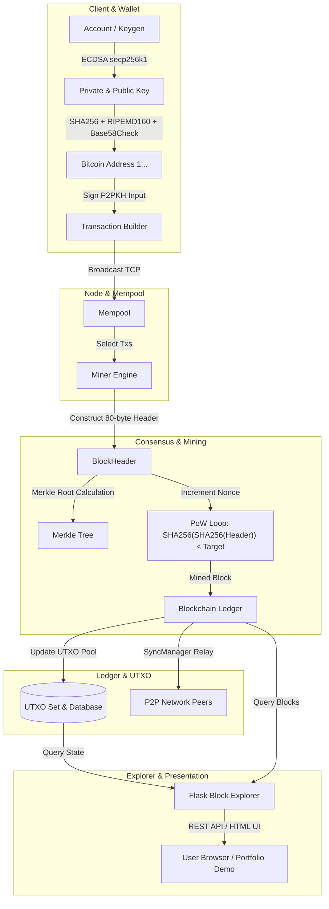

# Genesis — Bitcoin Blockchain in Python

<div align="center">

[](https://www.python.org/)
[](https://flask.palletsprojects.com/)
[](tests/)
[](https://mubius.github.io/Genesis/)
[](LICENSE)

**A Bitcoin protocol implementation built from scratch in Python.**  
Featuring secp256k1 elliptic curve cryptography, double-SHA256 proof-of-work mining, Forth-like P2PKH script execution, UTXO set management, a TCP peer-to-peer sync layer, and an interactive real-time block explorer.

[**Explore Live Web Demo**](https://mubius.github.io/Genesis/) • [**Quickstart**](#quickstart) • [**Architecture**](#architecture) • [**API Reference**](#api-reference)

</div>

---

## Overview

**Genesis** is a complete, educational implementation of Satoshi Nakamoto's Bitcoin protocol written from first principles in Python with zero high-level blockchain frameworks. It implements the entire transaction and consensus lifecycle:

- **Elliptic Curve Cryptography (`secp256k1`):** Finite field arithmetic modulo prime $p = 2^{256} - 2^{32} - 977$, point multiplication, ECDSA signing and verification, and Base58Check encoding for Bitcoin addresses (`1...`).
- **Proof-of-Work Consensus:** Double SHA-256 mining engine targeting dynamic difficulty targets with retargeting every 10 blocks (20s block time target). Includes 17 pre-mined real blocks with authentic cryptographic linkages.
- **UTXO Model & Script Virtual Machine:** Stack-based execution engine evaluating canonical Pay-to-Public-Key-Hash (P2PKH) scripts (`OP_DUP OP_HASH160 <pubKeyHash> OP_EQUALVERIFY OP_CHECKSIG`), coinbase reward distribution (50 BTC), and double-spend detection.
- **Peer-to-Peer Networking:** Multi-node TCP gossip server implementing custom binary `NetworkEnvelope` framing for block inventory, mempool broadcasting, and chain reorganization.
- **Modern Block Explorer Web Application:** Responsive dark-themed Flask dashboard showcasing live chain metrics, block header inspectors, transaction input/output graphs, mempool status, address QR codes, and REST APIs.
- **Interactive Web Client:** GitHub Pages compatible client with an in-browser Web Crypto proof-of-work mining simulator, keypair generator, and Script VM visualizer.

---

## Architecture



---

## Project Structure

```
Genesis/
├── .github/
│   └── workflows/
│       ├── ci.yml                 # Automated test matrix (Python 3.10-3.12)
│       └── pages.yml              # Automated GitHub Pages deployment
├── blockchain/
│   ├── Blockchain/
│   │   ├── Backend/
│   │   │   ├── core/
│   │   │   │   ├── EllepticCurve/ # secp256k1 field arithmetic, points, ECDSA
│   │   │   │   ├── database/      # JSON file persistence (chain, accounts, nodes)
│   │   │   │   ├── network/       # TCP P2P connection & syncManager
│   │   │   │   ├── block.py       # Block data model & binary serialization
│   │   │   │   ├── blockHeader.py # 80-byte header, mining loop, hash verification
│   │   │   │   ├── blockchain.py  # Chain state machine & daemon loop
│   │   │   │   ├── Script.py      # Stack-based Script execution engine
│   │   │   │   └── Tx.py          # Tx, TxIn, TxOut data structures
│   │   │   └── util/              # Little-endian converters, Base58Check, varints
│   │   ├── Frontend/
│   │   │   ├── static/css/        # Block explorer styling
│   │   │   ├── templates/         # Jinja2 templates (home, block, tx, wallet, etc.)
│   │   │   └── run.py             # Flask application server & REST API
│   │   └── client/
│   │       ├── account.py         # Address & keypair generator
│   │       └── sendBTC.py         # Raw transaction broadcaster
│   ├── config.ini                 # Node networking configuration
│   └── data/                      # Persistent ledger data (17 mined blocks)
├── docs/                          # GitHub Pages interactive web application
│   ├── data/blocks.json           # Exported ledger seed data
│   ├── app.js                     # In-browser WebCrypto miner & explorer
│   ├── index.html                 # Interactive showcase portal
│   └── style.css                  # Fintech cyberpunk stylesheet
├── tests/
│   └── test_blockchain.py         # 19 automated unit & integration tests
├── main.py                        # Unified CLI entry point
├── requirements.txt               # Pinned Python package dependencies
└── README.md                      # Project documentation
```

---

## Core Technical Implementations

### 1. Cryptographic Foundation (`secp256k1`)
The cryptographic primitives are built directly from mathematical principles:
- **Field Elements:** Arithmetic over $\mathbb{F}_p$ with Fermat's Little Theorem for modular inversion ($a^{p-2} \equiv a^{-1} \pmod p$).
- **Elliptic Curve Points:** Point addition ($P + Q$) and point doubling ($2P$) on $y^2 = x^3 + 7 \pmod p$.
- **ECDSA Signatures:** Deterministic signing with RFC 6979 nonce generation, producing DER-encoded $(r, s)$ signatures.
- **Base58Check Encoding:** Converts raw 20-byte `HASH160(PubKey)` into Bitcoin mainnet addresses with a 4-byte double-SHA256 checksum, preventing typographical transfer errors.

### 2. Proof-of-Work Consensus & Block Headers
Canonical 80-byte binary header layout:

| Field | Size | Description |
|---|---|---|
| **Version** | 4 bytes | Protocol version integer |
| **Previous Block Hash** | 32 bytes | Little-endian SHA-256d hash of previous header |
| **Merkle Root** | 32 bytes | Root of transaction Merkle tree |
| **Timestamp** | 4 bytes | Unix epoch timestamp |
| **Bits** | 4 bytes | Compact exponent-mantissa representation of difficulty target |
| **Nonce** | 4 bytes | 32-bit counter incremented during mining |

### 3. P2PKH Script Execution Stack Machine
Transactions are verified using a Forth-like stack virtual machine:

$$\text{ScriptSig} + \text{ScriptPubKey} \longrightarrow \langle\text{sig}\rangle \; \langle\text{pubKey}\rangle \; \text{OP\_DUP} \; \text{OP\_HASH160} \; \langle\text{pubKeyHash}\rangle \; \text{OP\_EQUALVERIFY} \; \text{OP\_CHECKSIG}$$

1. $\langle\text{sig}\rangle$ and $\langle\text{pubKey}\rangle$ pushed from unlocking script.
2. `OP_DUP` duplicates top stack item ($\langle\text{pubKey}\rangle$).
3. `OP_HASH160` evaluates $\text{RIPEMD160}(\text{SHA256}(\text{pubKey}))$.
4. $\langle\text{pubKeyHash}\rangle$ pushed from locking script.
5. `OP_EQUALVERIFY` verifies that hashes match and removes them.
6. `OP_CHECKSIG` verifies signature against public key, pushing `1 (TRUE)`.

---

## Quickstart

### Prerequisites
- Python 3.10, 3.11, or 3.12
- Git

### Installation

```bash
# Clone the repository
git clone https://github.com/MUBIUS/Genesis.git
cd Genesis

# Create and activate a virtual environment
python -m venv .venv
# On Windows:
.venv\Scripts\activate
# On Linux/macOS:
source .venv/bin/activate

# Install dependencies
pip install -r requirements.txt
```

### Running the Block Explorer
Launch the local web explorer at `http://127.0.0.1:5900`:

```bash
python main.py
# Or explicitly:
python main.py --explorer --port 5900
```

### Generating Bitcoin Keypairs & Addresses
Generate a new cryptographic keypair and Base58Check address:

```bash
python main.py --account
```
*Output:*
```text
Private Key (Hex): 0xeaa5fd408bc3a0b49efdafff43b53eb99f137c4c9b89014643403857ca056183
Public Address:    1LqvrcJzzZgBLFr1vTJX8op9pyJgDLZudF
```

### Viewing Blockchain Summary Metrics
```bash
python main.py --info
```

### Running Automated Tests
```bash
python main.py --test
```
*Result:* **19 passing tests** across cryptography, consensus, headers, database, and Flask REST endpoints in under 0.3s.

---

## API Reference

The Flask block explorer exposes programmatic REST endpoints alongside its HTML interface:

| Method | Endpoint | Description |
|---|---|---|
| `GET` | `/` | Web Block Explorer dashboard |
| `GET` | `/block` | Paginated list of mined blocks |
| `GET` | `/block/<hash>` | Detailed block inspector (header, transactions) |
| `GET` | `/tx/<txid>` | Transaction detail inspector (inputs, outputs, scripts) |
| `GET` | `/transactions` | Current unspent transaction output (UTXO) pool |
| `GET` | `/mempool` | Unconfirmed memory pool transactions |
| `GET` | `/wallet` | Web wallet interface for P2PKH transaction broadcasting |
| `GET` | `/api/stats` | JSON summary: `{ "chain_height": 16, "total_blocks": 17, "total_transactions": 18 }` |
| `GET` | `/api/blocks` | JSON list of latest mined blocks |
| `GET` | `/search?q=<query>` | Omnisearch by block height (`0`), 64-char hash, or address |

---

## Live Demo on GitHub Pages

The repository includes a static web client deployed to **GitHub Pages** under the `/docs` folder:
👉 **[https://mubius.github.io/Genesis/](https://mubius.github.io/Genesis/)**

Features running directly in the browser:
- **Interactive Block Explorer:** Inspect the 17 pre-mined Genesis blocks with instant search.
- **Hardware-Accelerated WebCrypto Miner:** Mine valid double-SHA256 blocks with live hashrate telemetry and dynamic difficulty.
- **Key & Address Generator:** Create real secp256k1 keypairs with SVG QR code generation.
- **Script VM Step-by-Step Visualizer:** Walk through P2PKH stack execution with visual stack push/pop operations.

---

## License

This project is open-source under the [MIT License](LICENSE).
